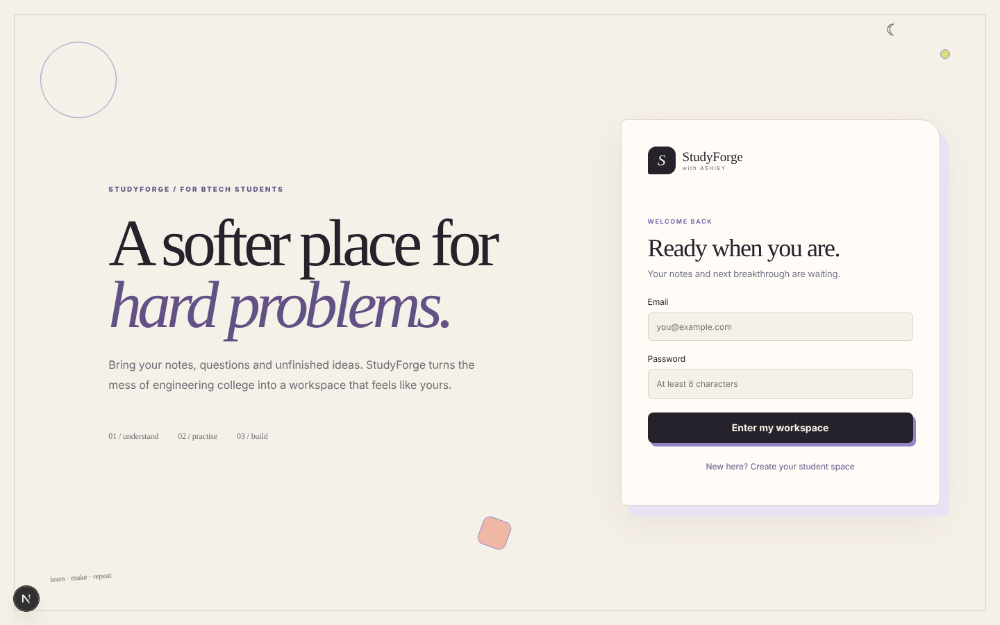
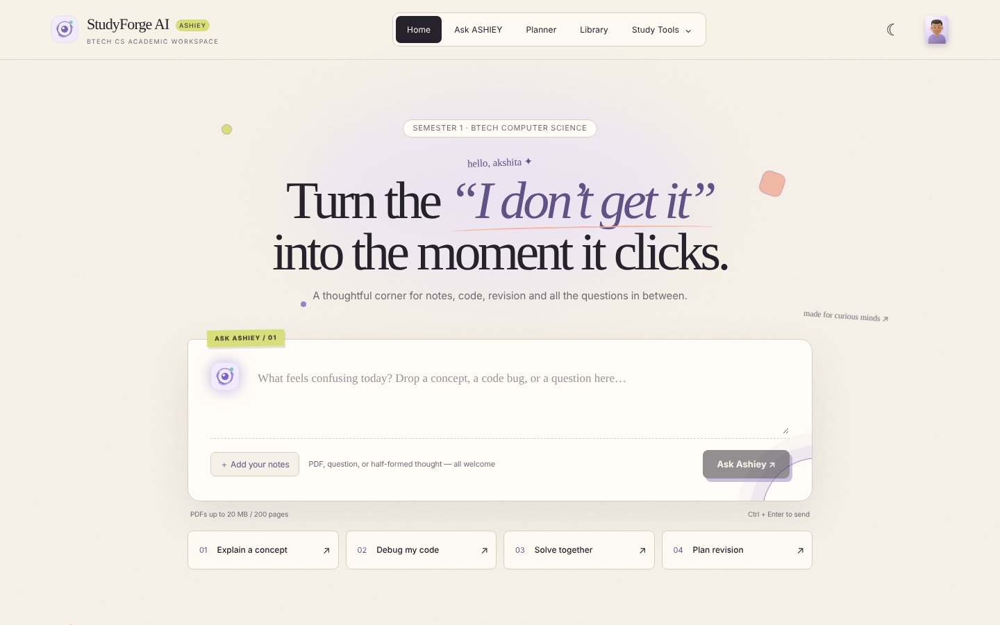
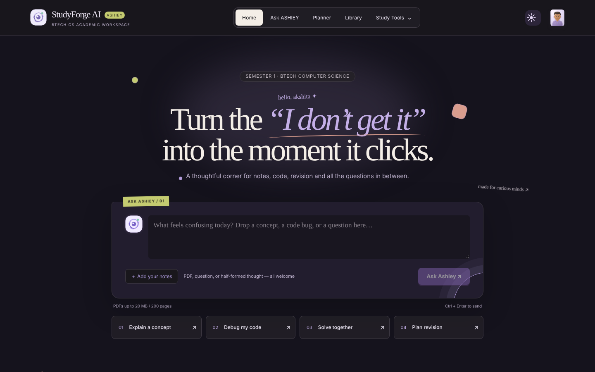
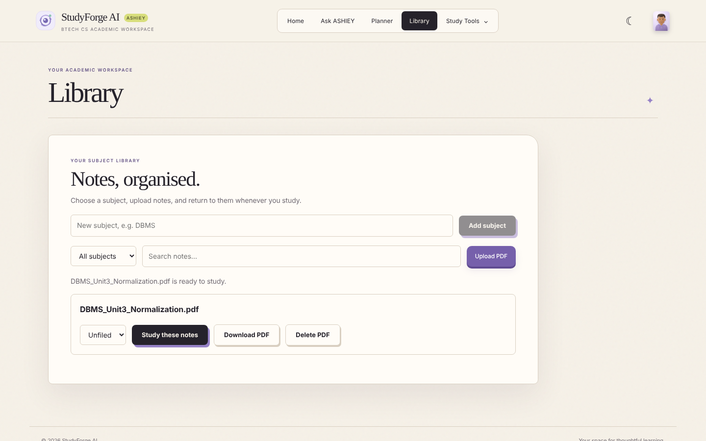
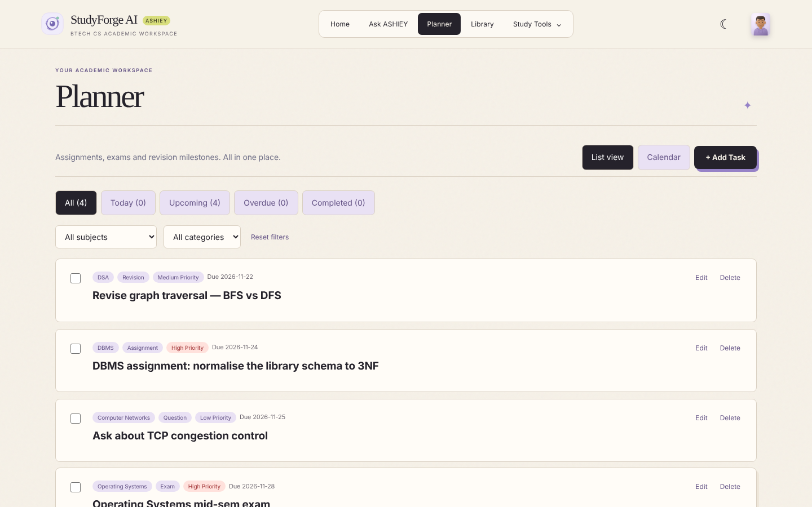
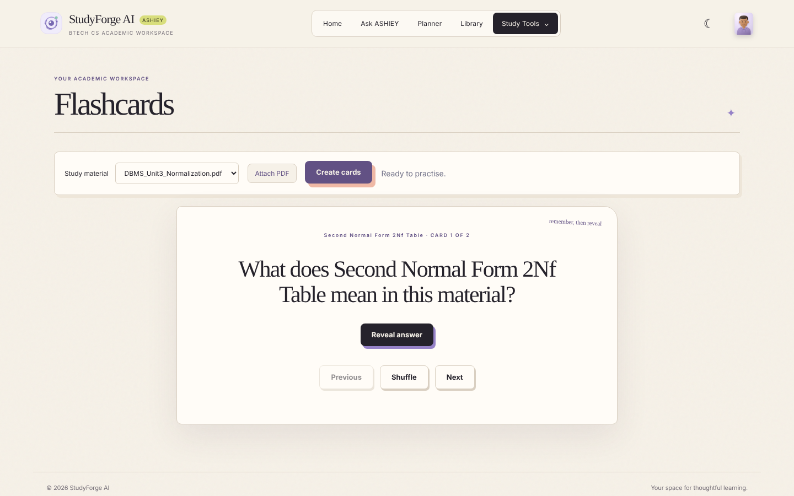
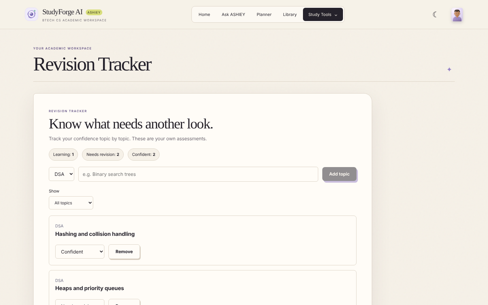
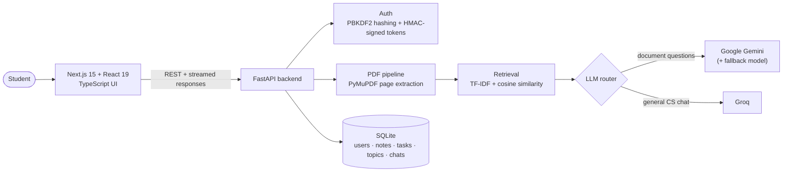

<div align="center">



# StudyForge AI

### Turn *"I don't get it"* into the moment it clicks.

**A full-stack, AI-powered study workspace for engineering students.**
Upload your notes, ask questions grounded in your own PDFs, and turn them into flashcards, quizzes, revision plans and progress you can see.

<p>
  
  
  
  
  
  
</p>
<p>
  <a href="https://github.com/akshita-sharda/STUDYFORGE-AI-/actions/workflows/ci.yml"></a>
  
  
  
  
</p>

[Features](#-features) · [Screenshots](#-screenshots) · [Architecture](#-architecture) · [Getting started](#-getting-started) · [Testing](#-testing)

</div>

---

## 💡 Why StudyForge?

Engineering study material is scattered across PDFs, class notes, chat threads and to-do lists. Generic chatbots don't know *your* syllabus and will happily make things up.

StudyForge brings everything into one calm workspace and keeps the AI **anchored to the student's own material**. It cites the page an answer came from and clearly separates *"from your notes"* from *"additional knowledge"*.

## ✨ Features

<table>
<tr>
<td width="50%" valign="top">

### 🧠 Ask ASHIEY, your AI study companion
- **Document-grounded answers (RAG)**: relevant passages are retrieved from your PDF and sent with the question, with page references
- **Study modes**: *Explain simply*, *Give me a hint*, *Debug my code* (reviews without executing) and *Viva practice*
- **Live streaming responses**, Markdown + **KaTeX math** rendering and one-click code copy
- **Saved conversations** you can resume, retry or start fresh

</td>
<td width="50%" valign="top">

### 📚 Subject library
- Create subjects and upload PDFs (up to 20 MB / 200 pages)
- Page-wise text extraction with **PyMuPDF**
- File notes by subject, search them and download originals
- One click: *"Study these notes"* opens a grounded session

</td>
</tr>
<tr>
<td valign="top">

### 🃏 Active-recall tools
- **Flashcards** generated from your notes, with shuffle and reveal
- **Practice quizzes** with scoring (plus a local fallback when the AI is unavailable)
- **Concept Recall** challenges built from your documents

</td>
<td valign="top">

### 📅 Plan & track
- **Planner** for assignments, exams, revision and questions, with list *and* calendar views
- **Revision tracker**: mark topics *Learning*, *Needs revision* or *Confident*
- **Progress dashboard** summarising tasks, materials and confidence
- **Personal profile** with a customisable 3D student avatar

</td>
</tr>
</table>

## 📸 Screenshots

> Captured from the running application with a sample DBMS notes PDF.

<table>
<tr>
<td width="50%"><p align="center"><b>Workspace home</b>: ask anything, or start from a study mode</p></td>
<td width="50%"><p align="center"><b>Dark mode</b>, designed rather than just inverted</p></td>
</tr>
<tr>
<td><p align="center"><b>Subject library</b>: upload and organise PDFs</p></td>
<td><p align="center"><b>Planner</b>: deadlines, priorities and categories</p></td>
</tr>
<tr>
<td><p align="center"><b>Flashcards</b> generated from your notes</p></td>
<td><p align="center"><b>Revision tracker</b>: honest self-assessment per topic</p></td>
</tr>
</table>

## 🏗 Architecture



**How a grounded answer works**

1. 📄 **Upload**: the PDF is split page by page with PyMuPDF and stored with its page numbers.
2. 🔎 **Retrieve**: the question is scored against the passages with **TF-IDF + cosine similarity** (scikit-learn), and the best excerpts are selected.
3. 🧩 **Generate**: the excerpts, recent conversation and chosen study mode go to Gemini. The answer **streams back live**, with page citations.
4. 🛟 **Recover**: if the primary model is overloaded, a fallback model is tried once, and quiz generation has a fully local fallback.

## 🧰 Tech stack

| Layer | Technologies |
| --- | --- |
| **Frontend** | Next.js 15 (App Router), React 19, TypeScript, React Markdown, remark-gfm, KaTeX |
| **Backend** | Python, FastAPI, Uvicorn, Pydantic |
| **AI / NLP** | Google Gemini (`google-genai`), Groq, scikit-learn TF-IDF retrieval |
| **Documents** | PyMuPDF |
| **Data & auth** | SQLite, PBKDF2-SHA256 password hashing, HMAC-signed session tokens |
| **Quality** | Pytest (39 backend tests), Playwright browser workflows |

## 📁 Project structure

```text
STUDYFORGE-AI-/
├── frontend/            # Next.js + TypeScript application (workspace, library, planner, tools)
├── backend/             # FastAPI service: auth, PDFs, retrieval, AI, study data
│   └── tests/           # 39 Pytest tests (API, chat, streaming, planner, AI reliability…)
├── docs/
│   ├── screenshots/     # UI screenshots used in this README
│   ├── guides/          # Project book, backend/frontend deep-dives, viva guide (PDF + DOCX)
│   ├── presentations/   # Mid-term and team presentation decks
│   ├── reports/         # Progress reports and presentation notes
│   └── design/          # UI design explorations
├── START-STUDYFORGE.cmd # One-click launcher (Windows)
└── STOP-STUDYFORGE.cmd
```

## 🚀 Getting started

**Prerequisites:** Python 3.11+, Node.js 20+, and a [Gemini API key](https://aistudio.google.com/) for AI features. Everything else works without a key.

### One click (Windows)

Double-click **`START-STUDYFORGE.cmd`**. It starts both services and opens `http://127.0.0.1:3000`. Use `STOP-STUDYFORGE.cmd` when you're done.
In VS Code you can instead run the **Start StudyForge AI** build task.

### Manual setup (any OS)

```bash
# 1. Backend
cd backend
python -m venv .venv
source .venv/bin/activate          # Windows: .\.venv\Scripts\Activate.ps1
pip install -r requirements.txt
cp .env.example .env               # add GEMINI_API_KEY and a long ASHIEY_TOKEN_SECRET
uvicorn app.main:app --reload --port 8000
```

```bash
# 2. Frontend (new terminal)
cd frontend
npm install
npm run dev -- --port 3000
```

Then open **http://localhost:3000** and create your student space.

## 🧪 Testing

```bash
cd backend
pytest tests -q        # 39 tests: auth, documents, chat, streaming, planner, quizzes, AI reliability
```

```bash
cd frontend
npm run build          # type-check + production build
```

The frontend also includes Playwright workflows (`check-*.cjs`) that mock the API to test library, revision, saved-chat, code-copy and mobile-layout flows without a live account or AI calls.

## 🛣 Roadmap

- [ ] Public hosted demo
- [ ] Embedding-based semantic search to complement TF-IDF retrieval
- [ ] OCR for scanned PDFs
- [ ] Spaced-repetition scheduling for flashcards
- [ ] Planner reminders and calendar export

## ⚠️ Notes & limitations

- AI answers depend on Gemini availability and quota. Always double-check important facts against your course material.
- Very large or poorly scanned PDFs may be processed in batches or need clarification.
- *Debug my code* reviews code; it never executes it.

## 📚 Documentation

Detailed write-ups live in [`docs/guides`](docs/guides): a 30-page project book, full backend and frontend explanations, and a theory & viva guide.

---

<div align="center">

**Designed and built by [Akshita Sharda](https://github.com/akshita-sharda)**

If you find this project interesting, consider giving it a ⭐

</div>
