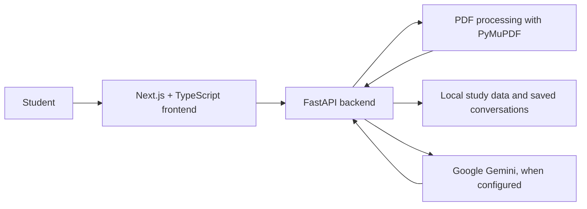

# StudyForge AI

<p align="center">
  <strong>An AI-assisted study workspace for organizing learning material, asking grounded questions, and planning revision.</strong>
</p>

<p align="center">
  
  
  
  
  
</p>

> **AI availability note:** answers depend on configured Gemini availability and quota. The application is designed to distinguish document-supported answers from additional knowledge; it is not a substitute for checking original course material.

## Overview

StudyForge AI is a full-stack learning workspace that helps students keep study material, conversations, revision progress, quizzes, flashcards, and planning activity in one place. It combines a Next.js frontend with a FastAPI backend and PDF processing.

## Why it was built

Study material is often scattered across PDFs, notes, chats, and to-do lists. StudyForge AI brings those workflows together while keeping the learning context visible and encouraging students to return to their source material.

## Features

- **Subject library** — create subjects, upload PDFs, organize notes, search material, and select documents for study activities.
- **AI study modes** — explain simply, provide hints, review code without executing it, and support viva practice.
- **Document-aware assistance** — uses a selected document, contextual excerpts, question, and recent conversation to support responses with page references where available.
- **Quiz and flashcard workflows** — generate and practise revision material from selected study content.
- **Saved conversations** — resume prior discussions, retry failed saves, and start fresh threads.
- **Revision tracker** — record topics as Learning, Needs revision, or Confident.
- **Planner** — track assignments, revision, exams, and pending questions with optional due dates.
- **Accessible presentation** — rendered answers are text rather than raw HTML; code blocks include copy controls and the interface respects reduced-motion preferences.

## Architecture



## Technology stack

| Area | Tools |
| --- | --- |
| Frontend | Next.js, React, TypeScript, React Markdown, KaTeX |
| Backend | Python, FastAPI, Uvicorn |
| Document processing | PyMuPDF |
| AI integration | Google GenAI / Gemini |
| Testing | Pytest, Playwright |
| Supporting libraries | scikit-learn, HTTPX, python-dotenv |

## Project structure

```text
STUDYFORGE-AI-/
├── backend/          # FastAPI service, PDF and AI-facing workflows
├── frontend/         # Next.js application
├── ASHIEY/           # Study-assistant related project material
├── .vscode/          # VS Code task configuration
├── START-STUDYFORGE.cmd
├── STOP-STUDYFORGE.cmd
├── start-studyforge.ps1
├── stop-studyforge.ps1
├── STUDY-FEATURES.md
└── README.md
```

## Getting started

### Prerequisites

- Python and Node.js installed locally
- A configured Gemini integration for AI-dependent features

### Start everything on Windows

1. Clone the repository and open its root folder.
2. Double-click `START-STUDYFORGE.cmd`.
3. The launcher starts the backend and frontend, then opens the application at `http://127.0.0.1:3000`.
4. Use `STOP-STUDYFORGE.cmd` when finished.

### Run from VS Code

Open the repository root in VS Code and select **Start StudyForge AI** from the build-task menu. The provided task starts the API and website.

### Run services manually

Backend:

```powershell
cd backend
py -m venv .venv
.\.venv\Scripts\Activate.ps1
pip install -r requirements.txt
py -m uvicorn app.main:app --reload --port 8000
```

Frontend, in a second terminal:

```powershell
cd frontend
npm install
npm run dev -- --port 3000
```

## Validation

Backend checks:

```powershell
cd backend
.\.venv\Scripts\python.exe -m pytest tests -q --basetemp .pytest-tmp-features
```

Frontend build:

```powershell
cd frontend
npm run build
```

The frontend also contains a Playwright-based browser workflow that intercepts API calls so it can test library, revision, saved-chat, code-copy, and mobile-layout flows without creating a live account or calling Gemini.

## Current limitations

- Gemini responses depend on service availability and quota.
- Large, poorly scanned, or illegible PDFs can require clarification.
- Long documents may be handled in batches rather than a single response.
- Planner dates are organisational only and do not generate notifications.
- Debug mode reviews code; it does not execute code.

## Screenshots

Genuine screenshots will be added when a stable, shareable demo environment is available. This repository intentionally does not use fabricated UI images.

## Roadmap

- Add clear deployment documentation for a shareable demo.
- Add CI checks for the existing backend tests and frontend build.
- Add a curated screenshot gallery generated from the running application.
- Continue refining document-grounded learning flows.

## Author

Built by [Akshita Sharda](https://github.com/akshita-sharda).

---
<sub>StudyForge AI is a learning tool. Always verify important academic information against your original course sources.</sub>
